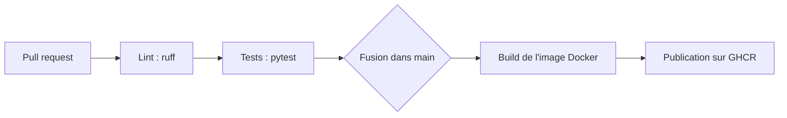

# mini-calculatrice

[](https://github.com/Crede241/mini-calculatrice/actions/workflows/ci.yml)

Petite application Python (addition, multiplication, division) créée pour apprendre le **CI/CD avec GitHub Actions**. L'application est volontairement simple : l'objectif est le pipeline qui l'entoure.

## Ce que fait le pipeline

À chaque `push` et à chaque pull request, GitHub vérifie la qualité du code et lance les tests. Quand le code est fusionné dans `main`, une image Docker est construite et publiée automatiquement.



| Étape | Outil | Quand |
|---|---|---|
| Qualité du code | `ruff` | push et pull request |
| Tests | `pytest` | push et pull request |
| Build et publication | Docker, GitHub Container Registry | push sur `main` uniquement, si les tests sont verts |

La configuration se trouve dans [`.github/workflows/ci.yml`](.github/workflows/ci.yml).

## Structure du projet

```
mini-calculatrice/
├── .github/workflows/ci.yml   # pipeline CI/CD
├── calculatrice.py            # fonctions addition, multiplication, division
├── app.py                     # point d'entrée en ligne de commande
├── test_calculatrice.py       # tests pytest
├── Dockerfile                 # image de l'application
├── requirements.txt           # dépendances (pytest, ruff)
└── README.md
```

## Installation en local (Windows, PowerShell)

```powershell
git clone https://github.com/Crede241/mini-calculatrice.git
cd mini-calculatrice
python -m venv .venv
.venv\Scripts\Activate.ps1
pip install -r requirements.txt
```

## Utilisation

```powershell
python app.py 3 x 4    # affiche 12.0
python app.py 10 / 2   # affiche 5.0
python app.py 2 + 3    # affiche 5.0
```

Les opérateurs acceptés sont `+`, `x` et `/`. La multiplication s'écrit `x` pour éviter que le terminal n'interprète `*`.

## Vérifier le code avant de pousser

```powershell
ruff check .
pytest
```

Ces deux commandes sont exactement celles exécutées par le pipeline : si elles passent chez toi, elles passent sur GitHub.

## Utiliser l'image Docker

L'image est publiée sur GitHub Container Registry à chaque fusion dans `main` :

```powershell
docker run --rm ghcr.io/crede241/mini-calculatrice:latest 3 x 4
```

Le paquet doit être public pour être téléchargé sans connexion (page du package, puis *Package settings*, puis *Change visibility*).

## Workflow de contribution

1. Créer une branche : `git switch -c ma-fonctionnalite`
2. Modifier le code, puis lancer `ruff check .` et `pytest`
3. Commit et envoi : `git add .`, `git commit -m "..."`, `git push -u origin ma-fonctionnalite`
4. Ouvrir une pull request sur GitHub
5. Fusionner quand le pipeline est vert

## Ce que ce projet illustre

- Déclencheurs de workflow (`push`, `pull_request`)
- Jobs et étapes, dépendance entre jobs (`needs`) et exécution conditionnelle (`if`)
- Lint et tests automatisés
- Branches, pull requests et vérifications obligatoires
- Livraison continue d'une image Docker avec `GITHUB_TOKEN` et les permissions minimales
